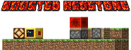

# Hello, and welcome to Boosted Redstone!

It’s a Minecraft Fabric mod designed to make Redstone more fun for enthusiasts like me.

### The stuff

 - A programmable processor
 - A key...

### The processor

It's basically a programmable block that uses a writable, signed book. You write some Lua code, sign the book and interact with the block. It sends redstone signals in four directions (north, south, east and west) based on the inputs.

### The key

It’s a key.
It’s currently about as useful as... well... nothing yet, but it looks great! More seriously, it’s intended for a special feature in a future version of the mod.

### HOW?

Two things: Firstly, Kaupenjoe and his tutorials, without whom none of this would have been possible, and secondly, IntelliJ IDEA, without which I would have lost my mind after two hours.

Have a question? Tough luck – you can't contact me by email [here](mailto:maysan.ishaq@gmail.com).